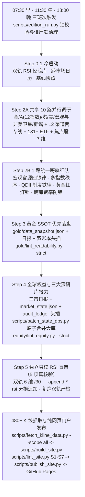

# Global Investment Research · 全球大类资产与跨周期投研门户

**「小白 3 分钟看懂 × 机构级 7 维硬核证据 × 480+ 标的零依赖交互 K 线终端」全球大类资产纯网页投研与自动化出版引擎**  
*Beginner-Friendly 3-Minute Clarity × Institutional 7-Dimension Hard Evidence × 480+ Instrument Zero-Dependency Interactive K-Line Terminal · Web-Only Global Multi-Asset Research & Automated Publishing Engine*

[](https://nanless.github.io/global-investment-research/)
[](#三班次节拍与-101-协同流水线--3-slot-schedule--pipeline)
[](#交互式-k-线终端与核心产品亮点--interactive-terminal--highlights)
[](#本地快速上手--zero-dependency-quick-start)
[](#三班次节拍与-101-协同流水线--3-slot-schedule--pipeline)
[](#三道严格质量防线--three-tier-quality-gates)

> 统一覆盖 **Layer 1 7 枚宏观气象与危机熔断邻近条**（含中美 10Y 利差与依据银发〔2026〕42号提示境内业务禁令、本项目配置为 0% 的 BTC 只读流动性温度计）、**Layer 2 对称 `3×2` 六大市场驾驶舱**（**5 核心**：A 股【上证指数 #1 领衔全 12 优先指数】× 港股【中国离岸折价腿，非海外分散】× 美股【8 指数 + 直达 QDII 入口】× **债券/现金与中美利率 `rates_bonds_core`** × 黄金【独立货币避险】 + **1 非美全球卫星 `non_us_global_satellite`**【日/欧/台韩/印 + `164824` 拟议退市风险提示 + 直达 QDII 入口】，同时保持 4 条完整日报正文轨不变）、**231 只全行业龙头零模板化 7 维深研 + 181+ 只正交标注（`asset_class` × `region` × 6 通道）重点 ETF 雷达 + 480+ 标的交互 K 线终端**与**按 4 大执行角色分层的中国大陆 12 大个人多元合规渠道**（渠道 08 显式定名「QDII 跨境基金（场内溢价·直销与支付宝限购）、香港互认与理财通」，10 元起普惠渠道），每日 **`07:30 早报 · 11:30 午报 · 18:00 晚报`（北京时间）** 经共享 `10+1` 调研红队、黄金 SSOT 红灯联防与三道零容忍门禁（含静态站 Gate S1–S7）自动发布至纯网页静态门户。
>
> *An institutional-grade, beginner-friendly, web-only multi-asset research monorepo featuring a 7-pill Macro Weather & Crisis Ribbon (incl. CN-US 10Y spread & PBOC `银发〔2026〕42号` 0%-allocation read-only BTC liquidity thermometer), a symmetric 3×2 Six-Market Cockpit (5 Core Markets: A-Share [SSE #1] / HK / US / Rates-Bonds Core / Gold + 1 Unified Non-US Global Satellite, keeping all 4 full daily prose tracks unchanged), 231 zero-template 7-dimension stock dossiers, 181+ orthogonally tagged ETFs (`asset_class` × `region` × 6 channels), 480+ interactive K-line instruments, and 12 MECE China Personal Multi-Asset Channels grouped into 4 execution-role tiers — delivered 3× daily (`07:30` / `11:30` / `18:00` CST) with zero third-party dependencies.*

---

### 在线门户 8 大核心页面直达 · Live Portal Navigation

| 页面入口 | 在线直达链接 | 核心内容与使用场景 |
| :--- | :--- | :--- |
| **1. 首页总控驾驶舱** | [index.html](https://nanless.github.io/global-investment-research/) | **Layer 1 7 枚宏观气象与危机熔断邻近条**（含中美 10Y 利差与 `银发〔2026〕42号` BTC 只读流动性温度计）、**Layer 2 对称 `3×2` 六大市场驾驶舱**（5 核心 + 1 非美全球卫星，A 股政策主线·上证指数 #1 领衔）、**财经与政策前瞻日历（`#sec-policy-calendar`）**、**6 市场交互 K 线切换区**、**「我的钱包一键试算器」**、**全站统一自选速览 `★`**、4 大执行角色分层 12 渠道概览卡、181+ 正交标注 ETF 概览卡与 `data_caveats` 透明提示 |
| **2. 全屏交互 K 线终端** | [charts.html](https://nanless.github.io/global-investment-research/charts.html) | 覆盖 **480+ 全球核心指数、9 大非美全球指数、中国国债 2Y/10Y/30Y、中证 REITs `932047`/`932006`、港股 `HSCI`/`HSAHP`、`EURUSD`/`GBPUSD`/`USDHKD`、贵金属、大宗、181+ ETF 与 231 只个股**；双层 HiDPI Canvas、`MA`/`BOLL`/`EMA`/`安全锚` 叠加、`VOL`/`MACD`/`RSI`/`KDJ`/`ATR`/`BIAS` 副图、`红涨绿跌`/`绿涨红跌` 切换与 **10 秒白话技术体检条** |
| **3. 新手 3 分钟指南** | [guide.html](https://nanless.github.io/global-investment-research/guide.html) | 四笔钱框架、交互式钱包试算、四灯四色锁仓速读、三步怎么买与 **48 词高频金融术语白话速查** |
| **4. 12 大多元渠道与独立详情页** | [channels.html](https://nanless.github.io/global-investment-research/channels.html) | 按 **4 大执行角色分层**呈现中国大陆 12 大个人合规投资渠道总览 + 12 个独立详情页 `channels/<id>.html`（含 10 元起 **QDII 跨境基金（场内溢价·直销与支付宝限购）、香港互认与理财通**）+ 横向「全市场打新工具箱」与「双层风控警示墙」 |
| **5. 181+ 只重点 ETF 深度雷达** | [etfs.html](https://nanless.github.io/global-investment-research/etfs.html) | 正交标注 **`asset_class` × `region` × 6 大交易通道**（境内场内/离岸美股/境内 QDII/离岸港交所/非 QDII 港股通/爱尔兰 UCITS）的穿透费率、规模、折溢价预警、税负口径、**弹窗交互 K 线**与 7 维配置拆解 |
| **6. 231 股 7 维龙头筛选器 & 27 对 A/H 矩阵** | [screener.html](https://nanless.github.io/global-investment-research/screener.html) | A 股 76 / 港股 75 / 美股 80 全行业龙头四色锁仓筛选、实时鲜度徽章、**27 对 A/H 溢价与税后股息交互比价矩阵**（含港股通 20% 红利税实算）、**统一自选 `★`** 及 **7 维深度档案 + 安全锚 K 线双视图弹窗** |
| **7. 公开零篡改记分卡** | [scorecard.html](https://nanless.github.io/global-investment-research/scorecard.html) | 黄金与全球三市可证伪预判事后公开复盘（兑现 / 部分兑现 / 证伪），历史零篡改 |
| **8. 历史研报与月度档案** | [archive.html](https://nanless.github.io/global-investment-research/archive.html) | 黄金全景主报告（1971–2030）、三市常青旗舰手册与全部历史 **早报 (07:30) · 午报 (11:30) · 晚报 (18:00)** 独立筛选归档 |

---

## 交互式 K 线终端与核心产品亮点 · Interactive Terminal & Highlights

- **① 480+ 标的零依赖交互 K 线终端（`charts.html` + 首页 6 市场切换区 + `kline.js` + `fetch_kline_data.py`）**
  100% 原生 ES6 双层 HiDPI `<canvas>` 引擎，零外部 CDN 依赖；通过 `scripts/fetch_kline_data.py --scope all` 经多源官方/交易所公开接口（腾讯 `fqkline`/`usfqkline`、新浪期货/外汇/北交所/美股、FT 批量 POST 覆盖爱尔兰 UCITS、上金所 `Dailyhq`、中债/美国财政部官方利率 CSV、CBOE VIX CSV、Coinbase）生成 **480+ 标的**（含 9 大非美全球指数、中国国债 2Y/10Y/30Y 收益率、中证 REITs `932047`/`932006`、港股 `HSCI`/`HSAHP`、`EURUSD`/`GBPUSD`/`USDHKD`、181+ ETF 与 231 只个股）静态分片 JSON，实现全站毫秒级同源加载。支持 **`MA` / `BOLL` / `EMA` / 基本面 `安全锚` 叠加**、**`VOL` / `MACD` / `RSI` / `KDJ` / `ATR` / `BIAS` 副图**、`红涨绿跌`/`绿涨红跌` 一键切换，并内置受黄金红灯锁约束的 **「技术面 10 秒白话体检条」**（仅客观状态描述，零主动买入诱导词）。
- **② 对称 `3×2` 六大市场驾驶舱与全球多指数优先级矩阵（5 核心 + 1 非美全球卫星）**
  - **核心 1 · A 股（12 指数）**：**上证指数（`000001`）#1 领衔** → 沪深 300（`000300`）→ 深证成指（`399001`）→ 中证 A500（`000510`）→ 上证 50（`000016`）→ 创业板指（`399006`）→ 科创 50（`000688`）→ 中证 500 → 中证 1000 → 中证红利 → 北证 50 → 中证转债；
  - **核心 2 · 港股（5 基准 · 中国离岸折价腿，非海外分散）**：恒生指数（`HSI`）→ 恒生科技（`HSTECH`）→ 恒生国企（`HSCEI`）→ 恒生综合（`HSCI`）+ AH 溢价（`HSAHP`）；
  - **核心 3 · 美股（8 基准 + 直达 QDII CTA）**：标普 500（`SPX`）→ 纳斯达克综合（`IXIC`）→ 纳斯达克 100（`NDX`）→ 道琼斯（`DJI`）→ 罗素 2000（`IWM`）→ 标普等权（`RSP`）→ 费城半导体（`SOX`）→ VIX 恐慌指数；
  - **核心 4 · 债券/现金与中美利率（`rates_bonds_core`）**：中国国债 2Y/10Y/30Y、美债 2Y/10Y/30Y/TIPS、中美 10Y 利差、`GC001`/`DR001` 与中证 REITs（`932047`/`932006`）；
  - **核心 5 · 黄金与全球宏观（独立货币避险）**：伦敦现货金（`XAU`）→ COMEX 金（`GC`）→ 沪金（`AU0`）→ 上金所 `Au99.99`/`Au(T+D)` → 白银/原油/铜/DXY/`EURUSD`·`GBPUSD`·`USDHKD`·人民币·日元；
  - **卫星 6 · 非美全球卫星市场（`non_us_global_satellite` + 直达 QDII CTA）**：日本 #1（`513800`）、欧洲 #2（`159561`）、台湾/韩国 AI 晴雨表、印度场外观察清单及 `164824` LOF 拟议退市风险提示（覆盖 9 大非美全球指数）。
- **③ 四大高价值交互工具：7 枚宏观气象条 × 钱包试算 × 统一自选 `★` × 27 对 A/H 税后矩阵**
  - **Layer 1 7 枚宏观气象与危机熔断邻近条**：将全球危机总熔断阀（VIX 连 2 日 >30、日元 3 日急升 >3%、10 年美债 >5.25%、港银总结余 <400 亿港元）、**中美 10Y 利差** 与标明境内业务禁令与项目配置为 0% 的 **BTC 只读流动性温度计** 置顶可视化；
  - **「我的钱包一键试算器」**：直连实时红绿灯与黄金零新仓规则，输入任意闲钱金额与账户条件（有无存量黄金、是否含离岸港美户、个税税档），纯本地零上传秒算四笔钱金额、单股 8% 上限、50 万存保拆分与小额门槛替代；
  - **全站统一自选清单 `★`**：跨首页、`screener.html`、`etfs.html`、`charts.html` 共享 `localStorage` 自选并支持 URL 哈希跨设备一键分享；
  - **27 对 A/H 溢价与税后股息交互比价矩阵**：用同日行情和汇率计算溢价。已核公告口径且适用港股通个人股息税的记录按 20% 测算，待确认的分派和源头扣缴单独标明。
- **④ 小白三层漏斗 × 黄金 SSOT 跨轨互斥锁 × 100% 零第三方依赖**
  全站落实 **「30 秒红绿灯白话结论 → 10 万/1 万元钱包实算与三步怎么买 → 机构级 7 维硬核证据」** 与 **48 词全站术语浮窗 + WCAG 深浅色模式**；`gold/data_snapshot.json` 拥有全仓库唯一写入权，红灯期由 Gate C2 + Gate S6/S7 跨轨阻断全站任何新买黄金指令与金矿标绿；所有构建、几何防撞、K 线抓取与质检脚本 100% 仅用 **Python 3.12+ 标准库** 与原生 JS/CSS，零离线二进制附件。

---

## 全景资产覆盖矩阵 · Multi-Asset Coverage Matrix

| 资产板块 | 实时覆盖规模 | 结构与呈现口径 | 权威数据底座（SSOT） |
| :--- | :--- | :--- | :--- |
| **对称 `3×2` 六大市场驾驶舱** | **5 核心（A 股 × 港股 × 美股 × 债现中美利率 × 黄金）+ 1 非美全球卫星** | 保持 **4 条完整日报正文轨**不变：黄金 1971–2030 全景主报告（7 图）+ 每日早/午/晚主刊（3 图）；三市 7 维大盘常青旗舰（各 7 图）+ 每日早/午/晚主刊（≥2 图）与守望刊（≥1 图）；债现利率与非美全球经六市卡片/渠道/ETF/K 线承载 | `gold/data_snapshot.json` / `equity/state/market_state.json` |
| **全市场交互 K 线** | **480+ 全球核心标的** | 6 市场交互切换区 + `charts.html` 静态分片 JSON（含 9 非美指数、中国 2Y/10Y/30Y、REITs `932047`/`932006`、`HSCI`/`HSAHP`、`EURUSD`/`GBPUSD`/`USDHKD`）+ 双层 HiDPI Canvas + 10 秒白话体检条 | `equity/state/klines/*.json` → `_site/assets/klines/*.json` |
| **12 大个人多元合规渠道** | **按 4 大执行角色分层 · 12 大 MECE 渠道 + 打新工具箱 + 双层风控墙** | 每渠道含统一红/黄/绿灯、小白一句话、今日避坑与独立详情页 `channels/<id>.html`，渠道 08 显式定名「**QDII 跨境基金（场内溢价·直销与支付宝限购）、香港互认与理财通**」（10 元起普惠渠道，非高净值专属） | `equity/state/multi_asset_channels.json` |
| **全球重点 ETF 雷达** | **181+ 只重点 ETF**（实时总数与分布以 `equity/state/etf_universe.json` 为准） | **正交三维标注**：`asset_class` × `region` × **6 大交易通道**（境内场内 / 离岸美股 / 境内 QDII / 离岸港交所 / 境内非 QDII 港股通 / 爱尔兰 UCITS），首页概览卡直跳预筛选 `etfs.html` | `equity/state/etf_universe.json` |
| **全球核心龙头 7 维档案** | **231 只全行业龙头**（A 股 **76** / 港股 **75** / 美股 **80**）+ **27 对 A/H 孪生比价** | 弹性维护 65–85 只/市；每只股票配备零模板化 7 维机构级深度档案（护城河、现金流/债墙、估值分位/AH 比价、股东回报/筹码、政策/财报日历、空头证伪底线、IF→THEN 锚与 ETF 替身）+ 安全锚叠加 K 线 | `equity/state/deep_dossiers.json` |

<details>
<summary><strong>点击展开：中国大陆 12 大个人多元合规渠道标准 ID 与制度边界速查</strong></summary>

| # | 渠道名称 | 标准 `id`（详情页 `channels/<id>.html`） | 核心覆盖与制度风控边界（实时数值见 SSOT） |
| :---: | :--- | :--- | :--- |
| 1 | 活钱与现金管理 | `reverse_repo` | 国债逆回购 `GC001`/`R-001`（周四 3 天息、节前倒数第 2 日窗）、货基、现金理财、同业存单 AAA |
| 2 | 人民币银行存款全家桶 | `large_cds` | 定存、大额存单（多数大行禁二次转让、二手单严禁直接提前支取）、结构性存款、50 万存保红线 |
| 3 | 境内个人外币存款与理财 | `fx_deposits_wm` | 美元/港元定存与外币理财、结售汇点差与人民币汇兑真实年化实算、5 万美元额度边界 |
| 4 | 债券与债券 ETF | `bonds` | 储蓄国债、超长期特别国债、银行间短融 `511360` 与交易所公司债/科创债 ETF（分别核对年报税项和持有人端规则） |
| 5 | 公募基金、银行理财与投顾 | `funds_wm` | 真净值理财（终结估值平滑）、纯债/固收+、多资产 ETF-FOF、持牌基金投顾与 2026 销售费改 |
| 6 | 储蓄型商业保险 | `savings_insurance` | 增额终身寿险、养老年金、分红险（退保现金价值真实 IRR、实现率与前期退保损失穿透） |
| 7 | 个人养老金与税优账户 | `tax_advantaged_accounts` | 1.2 万/年缴费抵税上限与领取 3% 税率边际盈亏线（边际税率 ≥20% 显著合算）、Y 份额与税优健康险 |
| 8 | QDII 跨境基金（场内溢价·直销与支付宝限购）、香港互认与理财通 | `qdii_mrf` | **10 元起普惠跨境渠道（非高净值专属）**：场内高溢价临停预警与溢价-排队盈亏平衡；TA 账户按身份证跨三方合并 vs 官方直销 App/支付宝分轨；互挂 ETF 穿透双层费；美元现汇同占 SAFE 额度；香港互认基金（MRF）分开核对转让差价与分配收益的税制、申赎状态与份额特点；理财通 2.0；2026-08-07 LOF 征求意见稿拟设 `2027-12-31` 退出期限，具体安排查交易所及基金公告 |
| 9 | 可转债 | `convertible_bonds` | 零门槛 T+0 全市场 `511380`（管理与托管合计 0.20%/年）vs 主体 AA 及以上且评级展望非负面 `511180`（管理与托管合计 0.30%/年）、个券权限、去刚兑违约排雷、强赎 Z 标识与到期税后净兑付比对 |
| 10 | 公募 REITs 与不动产租金对比 | `c_reits` | 产权类（NOI/出租率/资本化率）vs 特许经营权类（含还本须看中债 IRR）、薄量限价与住宅租售比 |
| 11 | 非黄金大宗商品与白银/铂钯 | `commodity_etfs` | 豆粕 `159985`（贴水正展期）/有色/能化期货 ETF、白银原油 LOF 溢价磨损与拟议退市风险、铂钯合规渠道 |
| 12 | 合规私募与标品信托（合格投资者） | `private_funds_trust` | 按产品规则核验合格投资者和起投门槛、双层费率、锁定期/冷静期、净值化标品尽调与远离非标资金池 |

</details>

内地个人通过基金互认取得的份额转让差价暂免个税至 2027 年 12 月 31 日。香港基金分配收益适用 20% 代扣，实际税后到账以本次分配构成和公告为准。累计份额将收益留在基金内再投资。比较份额时同时看现金流、费率和对冲成本。 [差价暂免公告](https://www.mof.gov.cn/jrttts/202308/t20230822_3903656.htm) · [分配收益代扣规定](https://m.mof.gov.cn/zcfb/201512/t20151218_1620646.htm) · [基金分配公告示例](https://www.cifm.com/fund/968000/announce/202605/P020260513320069775402.pdf)

---

## 端到端系统架构 · End-to-End Architecture



---

## 三班次节拍与 10+1 协同流水线 · 3-Slot Schedule & Pipeline

工作日执行每日三场 **`07:30 早报 · 11:30 午报 · 18:00 晚报`（All-4-Main 四市全主刊正文轨不变，休市市场依计划切 `holiday_watch`）+ 共享 10+1 深研红队 + 5 项真核验盲审 + 480+ 交互 K 线刷新 + 纯网页发布**；三班单向允许窗严格统一为 **`[-5 分钟, +6 小时]`**（`07:25–13:30` / `11:25–17:30` / `17:55–次日 00:00` CST，黄金截点须早于或同分钟于权益且间隔 ≤6 小时）；`edition_run.py begin --scheduled` 自动清理**严格较早期号**（`0730 < 1130 < 1800`）、超 **2 小时**无进展且尚未进入推送的僵尸锁；本地三班次定时模板内置 **56 项精确无通配符预授权**（`automations/permissions.json`）；持续增长大文件统一经 **`scripts/patch_state_dbs.py`** 增量原子写入，彻底杜绝 300 秒流式超时。

| 班次与允许窗（CST） | 任务 ID | 单会话串行产出与分层刷新重点 |
| :--- | :--- | :--- |
| **每日 `07:30` 早报**<br>（`07:25–13:30`） | `daily-global-investment-research` | 黄金早报优先写 SSOT → A/港/美全发主刊（≥2 图；休市切 `holiday_watch` ≥1 图）；推进三大扩展库至当班 `edition_id`，聚焦隔夜美盘/美债/汇率、美股与爱尔兰 UCITS 官收、美股 QDII 溢价停牌、外币存理、港股夜期校正、盘前逆回购/打新/转债及 4–6 只焦点股 7 维 → RSI 盲审 + `fetch_kline_data.py` + 单次发布 |
| **每日 `11:30` 午报**<br>（`11:25–17:30`） | `daily-global-investment-research-midday` | 黄金午报锁定 `11:30` 上金所/沪金早盘与同刻平价溢价、四大行金条/金店牌价、09:15–09:30 官方宏观 → **A 股 11:30 官方早盘收盘**（全 12 优先指数、半日成交、中金所午盘基差、`10:30` 停牌 QDII 复牌溢价、逆回购与债市午盘）、**港股 11:30–11:45 午盘前**（`11:15` 官方 HIBOR、5 基准、除权配售与新股招股；南向午盘 12:00 后披露入 `data_caveats`）、**美股隔夜盘后终盘封账或休市守望** + 亚盘期货 → RSI 盲审 + `fetch_kline_data.py` + 单次发布 |
| **每日 `18:00` 晚报**<br>（`17:55–次日 00:00`） | `daily-global-investment-research-evening` | 黄金晚报优先写 SSOT → A/港/美全发主刊（≥2 图）；封账 A/港日终官收、中金所席位、南向、16:30 汇率与美股盘前及滞后盘后终盘，聚焦债券 ETF/逆回购日终利率、可转债/REITs 估值、非金商品收盘、场内 QDII 日终溢价停牌及 4–6 只焦点股 7 维 → RSI 盲审 + `fetch_kline_data.py` + 单次发布 |
| **周六 / 周日** | 周末专项 / 周度校准 | 周六 `07:30` 黄金周末专项 + 美股周五复盘（半日市发 `holiday_watch`，全休沿用）；**周六 `11:30`/`18:00` 与周日三班三市沿用旧稿**，**仅周日 `18:00` 班执行全量周度校准**：更新 12 大渠道中低频项、全量核对 181+ 正交标注 ETF 费率规模、轮换精修 231 股池中 **6–10 只核心龙头 7 维档案**并推进 `SCORECARD.md` 周频复盘 |

---

## 三道严格质量防线 · Three-Tier Quality Gates

| 质量防线 | 校验脚本与严格命令 | 覆盖门禁与核心拦截项（全部要求 `0 errors, 0 warnings`） |
| :--- | :--- | :--- |
| **防线 1：黄金源稿与双快照** | `gold/lint_readability.py --strict` | **Gates 0–5** + `edition_validation.py`：11 个 `DAILY_*` 组件（含 `DAILY_VISUAL`）Schema 与导语信号/噪音计数校验、升级版三档词表与全篇零内部词/说教口号、感叹号与 13 煽动词、加粗 ≤14% 与零裸数字反引号、三班次（07:30/11:30/18:00）`[-5m, +6h]` 宽限与四关精确复算、外置日历、记分卡与 RSI ≤180 行 |
| **防线 2：全球权益、21 图与跨轨锁** | `equity/lint_equity.py --strict` | **Gates 0–5 / Gate 3B / Cross-Project Gates C1–C3**：21 张 SVG 演练零重叠与 `CHART_A2` 期货贴水正负符号校验、附表二与 231 股 `deep_dossiers.json` 100% 闭环、12 大渠道与 181+ 正交标注 ETF 完整性及跨库费率一致性（含 `511380` 0.20% vs `511180` 0.30%）、A/H 物理一致、3 项已证伪税费误导拦截、跨项目黄金 SSOT 6h 校验与红灯全载体互斥锁、期铜传导与 `INDEX.md` 零死链 |
| **防线 3：纯网页静态站、几何与 K 线门禁** | `scripts/lint_site.py _site --strict` | **Gates S1–S7** + `scripts/svg_geometry.py`：HTML 结构与内部链接完整性、禁用任何离线二进制附件链接、全站（含所有 `.json`）零本地路径/密钥/内部工程词泄露、首页 7 枚宏观气象条 + 对称 `3×2` 六大市场驾驶舱 + 钱包试算 + 4 大执行角色 12 渠道概览卡 + 181+ ETF 概览卡强制核验、全站黄金红灯互斥锁、SVG 文本边界框几何零碰撞，以及 **Gate S7 全市场 480+ K 线分片与 `charts.html` 完整性校验** |

---

## 本地快速上手 · Zero-Dependency Quick Start

本地构建使用 **Python 3.12+** 标准库。其中站点构建、门禁和定时模板不依赖第三方 Python 包。

历史日报的日期地址保留原刊正文与原刊图表。当前 K 线、市场仪表和市场新闻跟随各市场的 `latest` 页面。A/H 溢价以同一交易日的两地行情与港元中间价复算。股息排序使用同一财年的原始分派公告，源头代扣待核的分派以税前列示。

站点验收要求 K 线清单、分片和研报状态同一期。新班清单须在该班权益截点或之后生成，期间引用的历史行情保留原交易日。清单按至少 480 条目标序列对账，包含以 ETF 报价展示的指数代理及按用途复用的交易档位。取数失败须有对应记录，缺少必需基准时保留上一版。局部刷新可用于排查，发布以全量刷新生成的分片为准。

```bash
# 1. 运行全链路零依赖回归测试
python3 -m unittest discover -s tests

# 2. 抓取全市场 480+ 标的静态分片 K 线、构建纯网页静态门户并执行 S1–S7 严格门禁
python3 scripts/fetch_kline_data.py --scope all
python3 scripts/build_site.py --out _site
python3 scripts/lint_site.py _site --strict

# 3. 本地浏览器即时预览门户（访问 http://127.0.0.1:8000 及 /charts.html）
python3 -m http.server -d _site 8000
```

```bash
# 4. 源稿排期计划与双轨严格门禁（支持 0730 / 1130 / 1800 三班次）
python3 equity/lint_equity.py --plan <YYYY-MM-DD_HHMM>
python3 gold/lint_readability.py --strict gold/daily/<YYYY-MM-DD_HHMM_班次_黄金深度研报.md>
python3 equity/lint_equity.py --strict
python3 scripts/publish_site.py --check-manuscripts

# 5. 大文件、增长型账本与月初跨月滚存原子命令（防 300s 超时）与纯网页发布
python3 scripts/patch_state_dbs.py --inspect channels
python3 scripts/patch_state_dbs.py --inspect review-candidate
python3 scripts/patch_state_dbs.py --apply --dry-run
python3 scripts/patch_state_dbs.py --prepend-gold-ledgers --dry-run
python3 scripts/patch_state_dbs.py --prepend-equity-audit --dry-run
python3 scripts/patch_state_dbs.py --append-gold-rsi --dry-run
python3 scripts/patch_state_dbs.py --append-equity-rsi --dry-run
python3 scripts/patch_state_dbs.py --rollover-equity-month --dry-run
python3 scripts/patch_state_dbs.py --archive-gold-ledgers --dry-run
python3 scripts/publish_site.py --dry-run
python3 scripts/publish_site.py --no-push
python3 scripts/publish_site.py --edition-token <token>
python3 scripts/edition_run.py complete <token>

# 6. 本机三班次定时模板安装（07:30/11:30/18:00 · 56 项精确预授权）、漂移校验与运行锁查看
python3 scripts/install_sidecars.py --dry-run
python3 scripts/install_sidecars.py
python3 scripts/install_sidecars.py --check
python3 scripts/install_sidecars.py --check-runtime
python3 scripts/edition_run.py status
```

状态补丁和 K 线刷新在替换文件前把回滚记录写入 Git 工作区管理目录。进程异常结束后，构建、发布和监测会等待恢复。重新执行中断的写命令，先恢复上一份完整数据，再继续更新。K 线刷新覆盖不足时保留上次完整分片。预取服务并行，单个批量源断开时跳过逐标的回补。抓取有全批预算，命令最多等待 260 秒；发生超时后按输出判断是否需要恢复事务，当班清单未生成则停止发布。若单个行情源返回的有效历史比缓存短，保留该标的原序列并披露原因。爱尔兰 UCITS 行情取对应交易所价位序列；断源时沿用同一挂牌口径的缓存并标注，空缓存则披露缺失。基金表现或净值不进入该挂牌的 K 线。

定时发布按期号单向推进。同一期可发布代码或内容勘误，较早的现行快照会被拦截。新版部署由 CI 生成 `assets/release.json`。`edition_run.py complete` 核对对应 Actions 作业，并逐个比对公网首页、四市最新日报、四份旗舰、渠道总览和 12 个详情页、ETF、选股器、新手指南、档案索引、记分卡及 K 线资源的发布摘要。支持 gzip 的连接按解码后完整文件的 SHA-256 校验。Actions 查询和公网文件校验有独立时限。恢复同一推送时保留最早保存凭证的时间，重复结案复用该提交的已存凭证。推送后登记前中断时，下班先核验同仓 `origin/main`；确认准确提交后补登记并继续验收。远端不可核或提交不同则继续保留原锁。公网返回旧版、混合资源或读取超时时，班次保留推送凭证并等待验收。

独立审稿回执将稿件原句、事实或推论类型、原始证据链接和复核结果绑定到候选版本。政策简报可用 `source_urls` 补充主链接 `source_url`。从 2026 年 11 月 29 日起，每篇新稿分别核对事实、复算与条件性推论。`published_policy_briefs` 列出首页和四市最新日报的公开简报，逐张核对完整摘要，并对该卡的主链接和每个补充链接单独记录事实核验。候选摘要同时绑定历史日报，`changed_historical_manuscripts` 列出须复核的增删改，纯原样月归无需重审。改稿后重新生成摘要、完成复核再发布。两轨通过 `previous_backfills` 对账上次发布的待补事项，同班修订也须对账；移除、改期或改写内容须登记原证和复查结果。核销须关联当班已核的原句、文件和同一来源。网页上的下次复查时间是复查计划。

暂停班次的模板可通过 `--check` 核对。准备运行的班次用 `--check-runtime` 核查任务注册、授权和项目实际设置。启用的班次须采用 Default 预设、开启终端沙箱、仅在沙箱内自动运行命令，并维持文件访问默认拒绝。安装后和任务设置改动后用同一解释器再次读回本机设置。设置漂移时，在 Antigravity 对应项目恢复 Default 并复验。班次推进与提交推送凭证时，会比对启动提交中的工作流、执行代码和研究规则；这些文件的维护先独立发布，再启动新班次。

ETF 和个股档案可在 `evidence` 中记录已核字段。每条填写 `field`、原始文档的 `source_url`、对应的统计日 `as_of` 和核对范围 `note`。字段更新时随更新提交该记录的完整有效证据列表，漏交时清掉被改字段的旧链接，保留其他字段的证据。弹窗展示逐条出处，报价使用同一期 K 线的交易日期和币种。档案编辑日独立显示，复权历史与当时成交价格可能不同。

个股弹窗将缺少字段级出处的条目标为「出处待核」。单条引用覆盖其备注所指的指标、期间或事实，仍需按所列范围判断估值与研究结论的依据。

日报焦点股表只用同一期、同修订号的档案库做数值对账。历史稿沿用原交易时点，使用原公告、历史行情或原始计算底表复查。正文缺少可定位的外部出处时，网页会标明。

A/H 矩阵使用同日双边价格和港元中间价核算溢价。股息比较要求两地普通现金股息属于同一期间，并有当时已公开的公告。在 `market_state.json` 的 `cross_market_linkages.ah_premium_radar.benchmarks[].cash_dividends.a` 和 `.h` 填写税前 `ordinary_cash_per_share`、`currency`、`period_start`、`period_end`、`published_date` 与 `source_url` 或 `source_urls`。链接使用已登记的交易所、监管披露平台或发行人域名，并指向具体公告。全年口径合计同一会计年度的普通中期和末期现金股息，剔除特别股息和非现金权益。

港股通可确认以人民币派发时，H 侧填人民币金额及 `cash_basis: "southbound_cny"`，用同日汇率将 H 股价格换算成人民币。只确认香港登记股东的港元派息时，页面展示税前估算，税后排名留空。H 股晚于当期最后分红登记日上市时，在 H 侧填 `status: "listed_after_record_date"` 和两个经公告核验的日期 `listed_date`、`last_record_date`。发行人的实际分派范围明确排除 H 股时，填 `status: "excluded_from_distribution"`。未参与分派的 H 股金额与币种留空。两地确实未派息才显示均为零。原始公告在价格待核时仍可查阅。 [沪港通股息红利税规定](https://www.mof.gov.cn/gp/xxgkml/szs/201411/t20141114_2510448.htm) · [深港通股息红利税规定](https://www.mof.gov.cn/gp/xxgkml/szs/201612/t20161201_2510630.htm)

---

## 实时行情·政策·时政监测与微信推送（本地运行）

除每日 `07:30 / 11:30 / 18:00` 三班次定时主刊外，仓库配套零第三方依赖的**本机伴随实时监测与合规微信推送工具**（`scripts/realtime_monitor.py` + `scripts/wechat_notify.py`）。它**完全独立于 56 项定时自动化权限清单**，以**严格只读**方式消费仓库 SSOT（`gold/data_snapshot.json`、`equity/state/market_state.json`、`equity/state/policy_calendar.json`），告警去重与冷却状态统一落盘至 **`.git/realtime-monitor.sqlite3`（零仓库工作树污染、永不误提交）**，并**100% 继承黄金红灯互斥锁**（红灯期严禁触发任何买金提示）。

### 1. 30 秒外置密钥配置（密钥永不入库）

将仓库内的脱敏样例复制至本机用户配置目录并锁定 `600` 权限，按需填入任一合规微信推送通道凭证：

```bash
mkdir -p ~/.config/global-investment-research
cp automations/notify.example.json ~/.config/global-investment-research/notify.json
chmod 600 ~/.config/global-investment-research/notify.json
```

> **合规安全承诺（零封号风险）**：原生支持 **WxPusher**、**企业微信群机器人（Webhook）**、**PushPlus**、**Server酱（Turbo）** 四大官方/合规 HTTPS 推送通道，**绝不依赖任何个人微信协议 Hook、非官方桌面外挂或模拟登录**，零个人微信封号风险。

### 2. 常用运行命令（体检 · 演练 · 常驻守护 · 开机自启）

```bash
# 1. 环境、SSOT、红灯锁与推送通道一键体检
python3 scripts/realtime_monitor.py --doctor

# 2. 单次干跑演练（拉取公开行情和新闻，输出预览，关闭外部模型和通知投递）
python3 scripts/realtime_monitor.py --once --dry-run

# 3. 启动本地常驻守护进程（按盘口时段轮询异动、政策新闻与临近财经日历提醒）
python3 scripts/realtime_monitor.py --daemon

# 4. 导出 macOS launchd 开机/后台保活 plist 模板（自行落盘至 ~/Library/LaunchAgents/）
python3 scripts/realtime_monitor.py --print-launchd
```

生产监测可以通过 `--data-root` 读取独立的已验收发布目录。该目录沿用仓库相对路径，包含黄金快照、黄金市场日历、权益市场状态、政策日历与 `equity/state/klines/core.json`，四份带期号的数据必须同班。每轮只解析一次目录入口，适合通过原子替换的目录链接切换班次。`--doctor --data-root /path/to/release-inputs` 可只读核对所选目录。`--print-launchd` 会保留指定的 `--data-root`、`--state-db` 和 `--notify-config` 参数。默认仍读取当前工作区。

只有时分的行情显示为日期待核，仅供参考。监测使用带日期的近期观测评分，告警注明供应商和观测时间。日历里的 `monitor_window_min: 0` 关闭高频轮询与倒计时，时间待定的事件保留在日历中。

### 3. 可选 Tier-2 大模型突发快解与门户 `#sec-policy-calendar` 联动

- **可选 Tier-2 LLM 突发深度白话解读**：默认零外部依赖，仅用本地规则引擎与结构化模板生成 5 段式微信建议卡；若在本机环境变量中配置 **`GEMINI_API_KEY`** 或 **`OPENROUTER_API_KEY`**（按需二选一，不写入仓库）并通过 **`--enable-llm`**（或设置 **`GIR_MONITOR_LLM=1`**）开启，捕获重磅央行、财政、关税或地缘事件时，可选入一条预写的定性传导假设。原文、仓位纪律和证伪条件由本地来源与规则生成，且出站仍强制经过黄金红灯锁与 `银发〔2026〕42号` 虚拟货币防火墙二次过滤。
- **与首页 `#sec-policy-calendar` 及三班次日报的闭环联动**：三班次（`07:30` / `11:30` / `18:00` CST）经 `equity/state/_edition_patch.json` 的可选 `policy_calendar` 键把未来 **14–30 天**全球重要财经数据与政策议程同步写入 `equity/state/policy_calendar.json`——**向上**统一驱动门户首页 **[#sec-policy-calendar](https://nanless.github.io/global-investment-research/#sec-policy-calendar)** 交互日历卡与 **首页精选 6–9 条跨市场要闻 + 单市场页 `#sec-market-news` 无上限全量重要新闻雷达与每篇黄金/A 股/港股/美股日报文内 4 列未来 7–14 天全北京时间日历表**（纯中文级别徽章，零裸 `P0`/`P1`）；**向下**实时喂给本机 `scripts/realtime_monitor.py`，在重大议息、通胀、关税、政治局/两会等窗口临近前主动微信提醒，实现「盘前日历预警 → 盘中异动推送 → 早/午/晚深度复盘」完整闭环。

---

## 精简目录地图与权威宪章索引 · Repository Map & Contracts

```text
global-investment-research/
├── AGENTS.md                        # 单仓库顶层统一编排宪章（三班次 10+1、多指数标准、K 线管线、政策日历、12 渠道与跨轨红线）
├── .agents/skills/                  # 统一工作区三 Skill（黄金出版 + 权益出版 + 权益编辑审校）
├── automations/                     # 共享三班次提示词、56 项无通配符精确权限清单、3 份定时模板与 notify.example.json 推送样例
├── gold/                            # 黄金深度研报体系（跨项目 SSOT 唯一写入源）
│   ├── AGENTS.md / market_calendar.json / data_snapshot.json / master_snapshot.json
│   ├── lint_readability.py / edition_validation.py / chart_input.py
│   └── daily/                       # 早/午/晚主刊、SCORECARD、CHANGELOG、AUDIT_LOG、archive/ 与 RSI 台账
├── equity/                          # 全球三市权益、181+ 正交标注 ETF 雷达与 12 大多元渠道研报体系
│   ├── GEMINI.md / DAILY_REPORT_SPEC.md / {a_share,hk_stock,us_stock}_market_report_{YYYY_MM,latest}.md
│   ├── edition_plan.py / lint_equity.py（及 21 张矢量 SVG 图表渲染模块）
│   ├── state/                       # market_state / multi_asset_channels / etf_universe / deep_dossiers / policy_calendar / klines/*.json / audit_ledger / RSI
│   └── daily/                       # 三市早/午/晚主刊与守望刊、总看板 INDEX、SCORECARD 与 CHANGELOG
├── scripts/                         # 零第三方依赖纯网页门户、交互 K 线抓取、几何检验、大库原子补丁、发布与本机实时监测引擎
│   ├── fetch_kline_data.py          # 480+ 标的静态分片 K 线零依赖抓取器（输出至 equity/state/klines/）
│   ├── build_site.py                # 静态门户构建器（首页 7 枚宏观条与 3×2 六市驾驶舱/#sec-policy-calendar/charts.html/12 独立渠道页/181+ ETF 雷达/231 股/27 对 AH/钱包试算/新手指南/记分卡/档案）
│   ├── svg_geometry.py              # SVG 矢量文本边界框解析与零碰撞/零越界几何校验引擎
│   ├── visual_widgets.py            # 零依赖 DAILY_VISUAL 640px 矢量信息图引擎（waterfall / bar_compare / anchor_range / flow_chain）
│   ├── patch_state_dbs.py           # 三库与 policy_calendar 原子合并、账本头插、双轨 RSI 无损追加、月初原子滚存/归档与 --inspect <target> 只读查库工具
│   ├── lint_site.py                 # 静态站 S1–S7 法证、安全与 K 线分片严格门禁
│   ├── publish_site.py / edition_run.py / install_sidecars.py
│   ├── realtime_monitor.py          # 本机伴随实时行情/政策/时政监测守护引擎（只读消费 SSOT，去重落 .git/realtime-monitor.sqlite3）
│   ├── wechat_notify.py             # 合规微信推送分发器（WxPusher/企业微信机器人/PushPlus/Server酱，密钥外置 ~/.config）
│   └── web_assets/                  # WCAG 深浅色样式 + app.js（48 词术语浮窗/钱包试算/自选 ★/AH 比价）+ kline.js（双层 Canvas K 线引擎）
├── tests/                           # 全链路零依赖回归测试集
└── .github/workflows/deploy-pages.yml
```

### 权威宪章与技能索引 · Authoritative Contracts

| 模块 | 权威文档 | 职责范围 |
| :--- | :--- | :--- |
| **顶层编排** | [AGENTS.md](AGENTS.md) | 单仓库三班次节拍、对称 3×2 六大市场驾驶舱、K 线管线、10+1 架构、12 渠道 4 层目录与跨轨硬不变式 |
| **黄金子轨** | [gold/AGENTS.md](gold/AGENTS.md) · [DAILY_FORMAT_SPEC.md](gold/daily/DAILY_FORMAT_SPEC.md) | 黄金 SSOT 唯一写入权、双快照防撕裂、四步红绿灯、午盘同刻平价与 6 门禁细则 |
| **权益与多元** | [equity/GEMINI.md](equity/GEMINI.md) · [DAILY_REPORT_SPEC.md](equity/DAILY_REPORT_SPEC.md) | 三市 7 维大盘、多指数优先级、12 渠道与 QDII 规则、181+ 正交标注 ETF、231 股 7 维深研与纯网页排版详规 |
| **工作区技能** | [黄金出版](.agents/skills/gold-research-publishing/SKILL.md) · [权益出版](.agents/skills/equity-report-publishing/SKILL.md) · [权益审校](.agents/skills/equity-research-editorial-qa/SKILL.md) | 21 图 Schema、三市休市滚存 SOP、10 项发前门禁、双账户与 QDII 税费规则与受控 RSI 盲审 |

---

## 免责声明 · Disclaimer

本仓库及在线门户所载全部研报、数据、图表、交互 K 线、技术指标与情景测算均基于公开官方市场与公司披露资料整理，**仅供投资研究、知识学习与风险教育参考，不构成任何针对个人的证券买卖要约、收益承诺或投资建议**。金融市场受利率、汇率、地缘政治与流动性多重风险影响，历史回溯、技术形态与概率框架不代表未来表现，投资决策请结合自身风险承受能力与专业持牌顾问意见独立审慎作出。

*All reports, datasets, charts, interactive K-lines, technical indicators, and scenario calculations in this repository and its web portal are compiled from public official market and regulatory disclosures for research and educational purposes only. Nothing herein constitutes personalized financial advice, an offer, or a solicitation to buy or sell any security. Markets carry interest-rate, currency, geopolitical, and liquidity risks; past performance, technical patterns, and probabilistic frameworks do not guarantee future results.*
