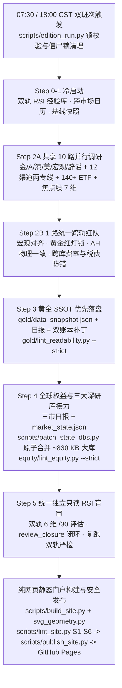

# Global Investment Research · 全球大类资产与跨周期投研门户

**「小白 3 分钟看懂 × 机构级 7 维硬核证据」全球大类资产纯网页投研与自动化出版引擎**  
*Beginner-Friendly 3-Minute Clarity × Institutional 7-Dimension Hard Evidence · Web-Only Global Multi-Asset Research & Automated Publishing Engine*

[](https://nanless.github.io/global-investment-research/)
[](#本地快速上手--zero-dependency-quick-start)
[](#核心亮点--why-this-repository)
[](#双班次节拍与-101-协同流水线--schedule--pipeline)
[](#三道严格质量防线--three-tier-quality-gates)

> 统一覆盖 **黄金**、**中国 A 股 × 中国香港股市 × 美国股市**（231 只龙头 7 维深研 + 140+ 只跨 6 通道重点 ETF 雷达）与 **中国大陆 12 大个人多元合规渠道**，每日 `07:30 / 18:00` 北京时间经共享 `10+1` 调研红队、黄金 SSOT 红灯联防与三道零容忍门禁自动发布至纯网页静态门户。  
> *An institutional-grade, beginner-friendly, web-only multi-asset research monorepo unifying Gold, China A-Share / HK / US Equities (231 seven-dimension dossiers + 140+ ETFs across 6 trading channels), and 12 MECE China Personal Multi-Asset Channels — built and verified with zero third-party dependencies.*

### 在线门户 7 大核心页面直达 · Live Portal Navigation

| 页面入口 | 在线直达链接 | 核心内容与使用场景 |
| :--- | :--- | :--- |
| **1. 首页总控驾驶舱** | [index.html](https://nanless.github.io/global-investment-research/) | 4 大市场红绿灯、小白「今日行动红绿灯 + 钱怎么分四笔」、12 大渠道概览卡、5 大市场/资产分组 ETF 概览卡与 `data_caveats` 透明提示 |
| **2. 新手 3 分钟指南** | [guide.html](https://nanless.github.io/global-investment-research/guide.html) | 四笔钱框架、四灯四色锁仓速读、三步怎么买与 24 词高频金融术语白话速查 |
| **3. 12 大多元渠道与独立详情页** | [channels.html](https://nanless.github.io/global-investment-research/channels.html) | 中国大陆 12 大个人合规投资渠道总览 + 12 个独立详情页 `channels/<id>.html` + 横向「全市场打新工具箱」与「双层风控警示墙」 |
| **4. 140+ 只重点 ETF 深度雷达** | [etfs.html](https://nanless.github.io/global-investment-research/etfs.html) | 覆盖 6 大交易通道的费率、规模、实时折溢价预警、税负口径与 7 维配置拆解弹窗 |
| **5. 231 股 7 维龙头筛选器** | [screener.html](https://nanless.github.io/global-investment-research/screener.html) | A 股 76 / 港股 75 / 美股 80 全行业龙头四色锁仓筛选与零模板化 7 维机构档案弹窗 |
| **6. 公开零篡改记分卡** | [scorecard.html](https://nanless.github.io/global-investment-research/scorecard.html) | 黄金与全球三市可证伪预判事后公开复盘（兑现 / 部分兑现 / 证伪），历史零篡改 |
| **7. 历史研报与月度档案** | [archive.html](https://nanless.github.io/global-investment-research/archive.html) | 黄金全景主报告（1971–2030）、三市常青旗舰手册与全部历史早晚主刊/守望刊归档 |

---

## 核心亮点 · Why This Repository

- **① 小白三层漏斗 × 24 词全站术语白话浮窗 × WCAG 深浅色模式**
  全站严格落实 **「30 秒红绿灯白话结论 → 10 万/1 万元双刻度钱包实算与三步怎么买 → 机构级 7 维硬核证据与官方自查」**，摒弃黑话墙与居高临下说教；站内自动为 `DXY`/`COT`/`CDS`/`ERP`/`IRR`/`DFII10` 等 **24 个核心金融术语**提供全站范围点按/悬停白话释义浮窗，配备 **WCAG 对比度达标的深色/浅色切换模式** 与 `guide.html` 三分钟入门图解。
- **② 黄金 SSOT 红灯跨轨互斥锁 × 跨库费率与图表符号硬门禁**
  `gold/data_snapshot.json` 拥有全仓库唯一写入权；当买金四步红绿灯处于 `Tier 0` 红灯或 `new_buy_allowed == false` 时，跨项目门禁（Gate C2）与静态站门禁（Gate S6）联合阻断全仓正文、三大扩展 JSON、全站网页与矢量 SVG 中任何新买/补仓黄金指令及金矿标绿；同时叠加 **跨库费率一致性检验**（如 `511380` 0.20% vs `511180` 0.30%）与 **`CHART_A2` 期货贴水正负符号校验**，防口径撕裂。
- **③ 非阻塞 `data_caveats` 信息透明 × 公开零篡改记分卡 × 维护者 `complete-superseded` 运维闭环**
  遇到休市、盘后延迟或权威数据源暂未归档时严禁编造、亦不阻塞准点发刊，系统通过纯读者中文 `data_caveats` 在首页与日报页自动披露缺口与影响边界；所有公开可证伪预判同步记入双轨 `SCORECARD.md` 接受事后客观回验，历史零篡改；维护者端提供受限运维命令 `complete-superseded` 处理已被后续部署覆盖的历史班次锁（严禁纳入定时自动化白名单）。
- **④ 100% Python 标准库零第三方依赖**
  从源稿门禁、24+ 张响应式矢量 SVG 图表渲染、文本边界框几何防重叠检验到完整双端静态门户生成，全部仅依赖 **Python 3.9+ 标准库**——无需 `pip install`、无需无头浏览器、彻底告别离线二进制文档附件。

---

## 全景资产覆盖矩阵 · Multi-Asset Coverage Matrix

| 资产板块 | 实时覆盖规模 | 结构与呈现口径 | 权威数据底座（SSOT） |
| :--- | :--- | :--- | :--- |
| **4 大核心市场** | **黄金 × 中国 A 股 × 中国香港股市 × 美国股市** | 黄金 1971–2030 全景主报告（7 图）+ 每日早晚主刊（3 图）；三市 7 维大盘常青旗舰（各 7 图）+ 每日早晚主刊（≥2 图）与升级守望刊（≥1 图） | `gold/data_snapshot.json` / `equity/state/market_state.json` |
| **12 大个人多元合规渠道** | **12 大 MECE 渠道 + 打新工具箱 + 双层风控警示墙** | 每渠道含统一红/黄/绿灯、小白一句话、今日避坑与独立详情页 `channels/<id>.html`，完整覆盖税费/存保/LOF 退市/IRR 穿透红线 | `equity/state/multi_asset_channels.json` |
| **全球重点 ETF 雷达** | **140+ 只重点 ETF**（实时总数与 6 通道分布以 `equity/state/etf_universe.json` 为准） | **底层 6 大交易通道**：境内场内 / 离岸美股 / 境内 QDII / 离岸港交所 / 境内非 QDII 港股通 / 爱尔兰 UCITS<br>**首页 5 大市场/资产分组概览卡**：A 股核心 / 港股三通道 / 美股核心 / 爱尔兰 UCITS 与全球 / 债券·转债·商品（点击直达预筛选 `etfs.html`） | `equity/state/etf_universe.json` |
| **全球核心龙头 7 维档案** | **231 只全行业龙头**（A 股 **76** / 港股 **75** / 美股 **80**） | 弹性维护 65–85 只/市；每只股票配备零模板化 7 维深度档案（护城河、现金流/债墙、估值分位/AH 比价、股东回报/筹码、政策/财报日历、空头证伪底线、IF→THEN 锚与 ETF 替身） | `equity/state/deep_dossiers.json` |

<details>
<summary><strong>点击展开：中国大陆 12 大个人多元合规渠道标准 ID 与边界速查</strong></summary>

| # | 渠道名称 | 标准 `id`（详情页 `channels/<id>.html`） | 核心覆盖与风控边界 |
| :---: | :--- | :--- | :--- |
| 1 | 活钱与现金管理 | `reverse_repo` | 国债逆回购 `GC001`/`R-001`（周四 3 天息、节前倒数第 2 日窗）、货基、现金理财、同业存单 AAA |
| 2 | 人民币银行存款全家桶 | `large_cds` | 定存、大额存单（多数大行禁二次转让、二手单严禁直接提前支取）、结构性存款、50 万存保红线 |
| 3 | 境内个人外币存款与理财 | `fx_deposits_wm` | 美元/港元定存与外币理财、结售汇点差与人民币汇兑真实年化实算、5 万美元额度边界 |
| 4 | 债券与债券 ETF | `bonds` | 储蓄国债、超长期特别国债、银行间短融 `511360` vs 交易所公司债/科创债 ETF（底层付息仍扣 20% 税） |
| 5 | 公募基金、银行理财与投顾 | `funds_wm` | 真净值理财（终结估值平滑）、纯债/固收+、多资产 ETF-FOF、持牌基金投顾与 2026 销售费改 |
| 6 | 储蓄型商业保险 | `savings_insurance` | 增额终身寿险、养老年金、分红险（退保现金价值真实 IRR、实现率与前期退保损失穿透） |
| 7 | 个人养老金与税优账户 | `tax_advantaged_accounts` | 1.2 万/年缴费抵税上限与领取 3% 税率边际盈亏线（边际税率 ≥20% 显著合算）、Y 份额与税优健康险 |
| 8 | 场内外 QDII、香港互认与理财通 | `qdii_mrf` | QDII 溢价临停预警、MRF 累计份额避 20% 派息税（严禁停申 `968118`）、理财通 2.0、2027 LOF 退市红线 |
| 9 | 可转债 | `convertible_bonds` | 零门槛 T+0 全市场 `511380`（综合费率 0.20%/年）vs 投资级 AA+ `511180`（综合费率 0.30%/年）、个券权限、去刚兑违约排雷、强赎 Z 标识与到期税后净兑付比对 |
| 10 | 公募 REITs 与不动产租金对比 | `c_reits` | 产权类（NOI/出租率/资本化率）vs 特许经营权类（含还本须看中债 IRR）、薄量限价与住宅租售比 |
| 11 | 非黄金大宗商品与白银/铂钯 | `commodity_etfs` | 豆粕 `159985`（贴水正展期）/有色/能化期货 ETF、白银原油 LOF 溢价磨损退市警报、铂钯合规渠道 |
| 12 | 合规私募与标品信托 300 万专享 | `private_funds_trust` | 合格投资者 300 万门槛、双层费率、锁定期/冷静期、净值化标品尽调与远离非标资金池 |

</details>

---

## 端到端系统架构 · End-to-End Architecture



---

## 双班次节拍与 10+1 协同流水线 · Schedule & Pipeline

工作日执行每日两场 **All-4-Main（四市全主刊）+ 共享 10+1 深研红队 + 纯网页发布**；单向截点宽限严格统一为 **`[-5 分钟, +6 小时]`**（`07:25–13:30` / `17:55–次日 00:00` CST，黄金截点须早于或同分钟于权益且间隔 ≤6 小时）；`edition_run.py begin --scheduled` 会自动清理**严格较早期号**、超 **2 小时**无进展且尚未进入推送的僵尸锁；为防大文件回写撞 300 秒流式超时，权益三大扩展大 JSON（合计 ~830 KB）与黄金历史双账本（`CHANGELOG.md` / `AUDIT_LOG.md`）统一写微型补丁并由预授权 **`scripts/patch_state_dbs.py`** 原子合并或无损头插。

| 班次（CST） | 任务 ID | 单会话串行产出与分层刷新重点 |
| :--- | :--- | :--- |
| **每日 `07:30`** | `daily-global-investment-research` | 黄金早报优先写 SSOT → A/港/美三市全发完整主刊（≥2 图；休市/半日市切 `holiday_watch` ≥1 图）；经 `patch_state_dbs.py` 推进三大扩展库至当班 `edition_id`，聚焦隔夜美盘/美债/汇率、美股与爱尔兰 UCITS 官收、QDII 溢价停牌、外币理财、港股夜期盲窗、盘前逆回购/转债/打新及当班 4–6 只焦点股 7 维刷新 → 统一 RSI 盲审与单次发布 |
| **每日 `18:00`** | `daily-global-investment-research-evening` | 黄金晚报优先写 SSOT → A/港/美三市全发完整主刊（≥2 图）；封账 A/港日终官收、中金所席位、南向、16:30 汇率与美股盘后终盘，聚焦债券 ETF/逆回购日终利率、可转债/REITs 估值、非金商品收盘、场内 QDII 日终溢价停牌及当班 4–6 只焦点股 7 维刷新 → 统一 RSI 盲审与单次发布 |
| **周六 / 周日** | 周末专项 / 周度校准 | 周六 `07:30` 黄金周末专项主刊 + 美股周五复盘主刊（半日市发 `holiday_watch`，全休沿用）；周六晚与周日三市默认沿用旧稿，**周日执行全量周度校准**：更新 12 大渠道中低频项、全量核对 140+ 只重点 ETF 费率规模、轮换精修 231 股池中 **6–10 只核心龙头 7 维档案**并推进 `SCORECARD.md` 周频复盘 |

---

## 三道严格质量防线 · Three-Tier Quality Gates

| 质量防线 | 校验脚本与严格命令 | 覆盖门禁与核心拦截项（全部要求 `0 errors, 0 warnings`） |
| :--- | :--- | :--- |
| **防线 1：黄金源稿与双快照** | `gold/lint_readability.py --strict` | **Gates 0–5** + `edition_validation.py`：10 个 `DAILY_*` 组件 Schema 与导语信号/噪音计数校验、升级版三档词表与全篇零内部词/说教口号、感叹号与 13 煽动词、加粗 ≤14% 与零裸数字反引号、双快照算术与四关精确复算（`[-5m, +6h]` 宽限与非阻塞 Cboe VIX）、外置日历、记分卡与 RSI ≤180 行 |
| **防线 2：全球权益、21 图与跨轨锁** | `equity/lint_equity.py --strict` | **Gates 0–5 / Gate 3B / Cross-Project Gates C1–C3**：21 张 SVG 演练零重叠与 `CHART_A2` 期货贴水正负符号校验、附表二与 231 股 `deep_dossiers.json` 100% 闭环、12 大渠道与 140+ 只重点 ETF 完整性及跨库费率一致性（含 `511380` 0.20% vs `511180` 0.30%）、A/H 物理一致、3 项已证伪税费误导拦截、跨项目黄金 SSOT 6h 校验与红灯全载体互斥锁、期铜传导与 `INDEX.md` 零死链 |
| **防线 3：纯网页静态站与几何校验** | `scripts/lint_site.py _site --strict` | **Gates S1–S6** + `scripts/svg_geometry.py`：HTML 结构与内部链接完整性、禁用任何离线二进制附件链接、全站零本地路径/密钥/内部工程词泄露、首页 4 市场 + 12 渠道概览卡 + 5 大市场/资产分组 ETF 卡强制核验、全站黄金红灯互斥锁与 SVG 文本边界框几何零碰撞校验 |

---

## 本地快速上手 · Zero-Dependency Quick Start

仅需 **Python 3.9+** 标准库，无需安装任何第三方包或浏览器二进制：

```bash
# 1. 运行全链路零依赖回归测试（95+ 用例）
python3 -m unittest discover -s tests

# 2. 构建纯网页静态门户并执行 S1–S6 严格门禁（含 SVG 几何校验）
python3 scripts/build_site.py --out _site
python3 scripts/lint_site.py _site --strict

# 3. 本地浏览器即时预览门户（访问 http://127.0.0.1:8000）
python3 -m http.server -d _site 8000
```

```bash
# 4. 源稿排期计划与双轨严格门禁（将占位符替换为目标期号与文件名）
python3 equity/lint_equity.py --plan <YYYY-MM-DD_HHMM>
python3 gold/lint_readability.py --strict gold/daily/<YYYY-MM-DD_HHMM_班次_黄金深度研报.md>
python3 equity/lint_equity.py --strict
python3 scripts/publish_site.py --check-manuscripts

# 5. 大文件原子增量补丁（防 300s 超时）与纯网页发布
python3 scripts/patch_state_dbs.py --apply --dry-run
python3 scripts/patch_state_dbs.py --prepend-gold-ledgers --dry-run
python3 scripts/publish_site.py --dry-run
python3 scripts/publish_site.py --no-push
python3 scripts/publish_site.py --edition-token <token>
python3 scripts/edition_run.py complete <token>

# 6. 本机双班次定时模板安装、漂移校验与运行锁查看
python3 scripts/install_sidecars.py --dry-run
python3 scripts/install_sidecars.py
python3 scripts/install_sidecars.py --check
python3 scripts/install_sidecars.py --check-runtime
python3 scripts/edition_run.py status
```

---

## 精简目录地图与权威宪章索引 · Repository Map & Contracts

```text
global-investment-research/
├── AGENTS.md                        # 单仓库顶层统一编排宪章（纯网页 10+1、12 渠道与跨轨红线）
├── .agents/skills/                  # 统一工作区三 Skill（黄金出版 + 权益出版 + 权益编辑审校）
├── automations/                     # 共享双班次提示词、无通配符权限清单与脱敏定时模板
├── gold/                            # 黄金深度研报体系（跨项目 SSOT 唯一写入源）
│   ├── AGENTS.md / market_calendar.json / data_snapshot.json / master_snapshot.json
│   ├── lint_readability.py / edition_validation.py / chart_input.py
│   └── daily/                       # 早晚主刊、SCORECARD、CHANGELOG、AUDIT_LOG、archive/ 与 RSI 台账
├── equity/                          # 全球三市权益、140+ 只重点 ETF 雷达与 12 大多元渠道研报体系
│   ├── GEMINI.md / DAILY_REPORT_SPEC.md / {a_share,hk_stock,us_stock}_market_report_{YYYY_MM,latest}.md
│   ├── edition_plan.py / lint_equity.py（及 21 张矢量 SVG 图表渲染模块）
│   ├── state/                       # market_state / multi_asset_channels / etf_universe / deep_dossiers / audit_ledger / RSI
│   └── daily/                       # 三市早晚主刊/守望刊、总看板 INDEX、SCORECARD 与 CHANGELOG
├── scripts/                         # 零第三方依赖纯网页门户、几何检验、大库原子补丁与发布引擎
│   ├── build_site.py                # 静态门户构建器（首页/12 独立渠道页/ETF 雷达/231 股/新手指南/记分卡/档案）
│   ├── svg_geometry.py              # SVG 矢量文本边界框解析与零碰撞/零越界几何校验引擎
│   ├── patch_state_dbs.py           # 权益三大扩展大 JSON 原子合并与黄金双账本无损头插工具（防 300s 超时）
│   ├── lint_site.py                 # 静态站 S1–S6 法证与安全严格门禁
│   ├── publish_site.py / edition_run.py / install_sidecars.py
│   └── web_assets/                  # WCAG 深浅色双端样式与零依赖交互脚本（含 24 词全站术语浮窗与 7 维/ETF 详情弹窗）
├── tests/                           # 全链路零依赖回归测试（95+ 用例）
└── .github/workflows/deploy-pages.yml
```

### 权威宪章与技能索引 · Authoritative Contracts

| 模块 | 权威文档 | 职责范围 |
| :--- | :--- | :--- |
| **顶层编排** | [AGENTS.md](AGENTS.md) | 单仓库双班次节拍、10+1 架构、12 渠道 MECE 目录与跨轨硬不变式 |
| **黄金子轨** | [gold/AGENTS.md](gold/AGENTS.md) · [DAILY_FORMAT_SPEC.md](gold/daily/DAILY_FORMAT_SPEC.md) | 黄金 SSOT 唯一写入权、双快照防撕裂、四步红绿灯与 6 门禁细则 |
| **权益与多元** | [equity/GEMINI.md](equity/GEMINI.md) · [DAILY_REPORT_SPEC.md](equity/DAILY_REPORT_SPEC.md) | 三市 7 维大盘、12 渠道、140+ ETF、231 股 7 维深研与纯网页排版详规 |
| **工作区技能** | [黄金出版](.agents/skills/gold-research-publishing/SKILL.md) · [权益出版](.agents/skills/equity-report-publishing/SKILL.md) · [权益审校](.agents/skills/equity-research-editorial-qa/SKILL.md) | 21 图 Schema、三市休市滚存 SOP、10 项发前门禁、双账户税费与受控 RSI 盲审 |

---

## 免责声明 · Disclaimer

本仓库及在线门户所载全部研报、数据、图表与情景测算均基于公开官方市场与公司披露资料整理，**仅供投资研究、知识学习与风险教育参考，不构成任何针对个人的证券买卖要约、收益承诺或投资建议**。金融市场受利率、汇率、地缘政治与流动性多重风险影响，历史回溯与概率框架不代表未来表现，投资决策请结合自身风险承受能力与专业持牌顾问意见独立审慎作出。

*All reports, datasets, charts, and scenario calculations in this repository and its web portal are compiled from public official market and regulatory disclosures for research and educational purposes only. Nothing herein constitutes personalized financial advice, an offer, or a solicitation to buy or sell any security. Markets carry interest-rate, currency, geopolitical, and liquidity risks; past performance and probabilistic frameworks do not guarantee future results.*
